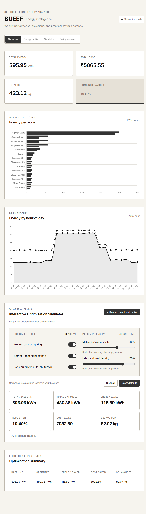
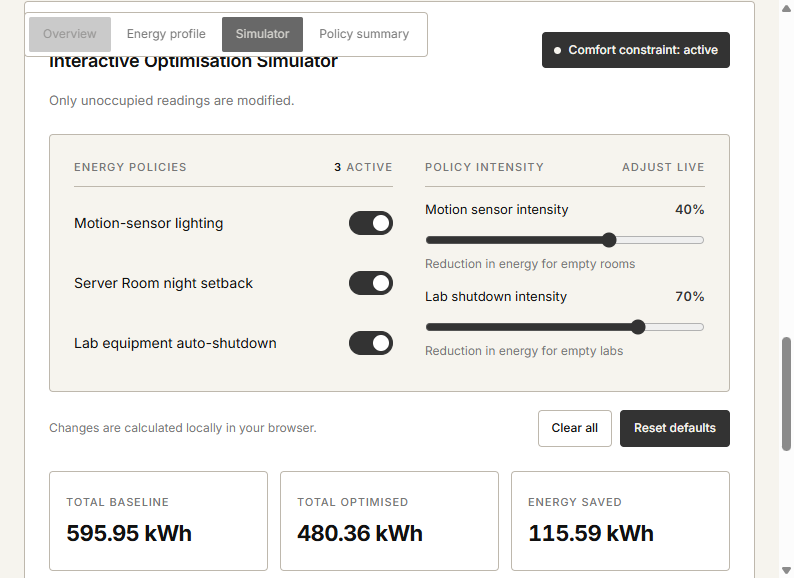

# BUEEF — Building Utility & Energy Efficiency Fine-Tuner

## Live Demo

Live demo: https://bueef.onrender.com

Note: hosted on Render's free tier — the first load may take ~30 seconds while the service wakes up.

*A Python-based energy analytics and optimisation tool that simulates a 14-zone school building, analyses its energy use, predicts hourly consumption, compares energy-saving scenarios, and displays results on a Flask dashboard.*

## Screenshots

### Dashboard overview

The dashboard presents weekly energy, estimated cost and emissions, zone-level consumption, and the daily energy profile.



### Interactive optimisation simulator

Toggle policies and adjust their intensity to see updated energy, cost, and emissions savings in the dashboard.



## How the Project Works

BUEEF models a school building as 14 zones distributed across three floors. It generates seven days of half-hourly readings—4,704 rows in total—and stores each zone's energy use, occupancy, and timestamp in SQLite. The data is simulated, with weekday schedules and small per-reading variation, so the project demonstrates an end-to-end analytics workflow without requiring physical meters.

The scripts and dashboard each serve a separate stage:

1. `generator.py` creates or refreshes the `zones` and `readings` tables with the synthetic week of data.
2. `validate.py` checks that the generated dataset has the expected coverage, valid values, continuous timestamps, unique readings, and intact zone references.
3. `analysis.py` uses SQL aggregations to report energy by zone, floor, and hour, estimate cost and emissions, and identify energy used when occupancy is zero.
4. `predict.py` compares a zone-and-hour average baseline with regression and Random Forest models. It trains on the first six days, tests on day seven, and flags unusually large prediction errors.
5. `optimize.py` estimates the effect of motion-sensor lighting, server-room night setback, and lab equipment shutdown. Its comfort check ensures the motion-sensor and lab rules do not alter occupied readings.
6. `app.py` serves a read-only dashboard and readings endpoint. The browser applies the selected policies locally, then updates the charts and savings figures without reloading or writing to the database.

## Interactive Demonstration

Open the [live dashboard](https://bueef.onrender.com) or start it locally with `python app.py`, then:

1. Review the baseline KPI cards and energy charts.
2. In the simulator, clear all policies to compare against baseline.
3. Enable individual policies or combine them; use the motion-sensor and lab sliders to change their reduction intensity.
4. Observe total optimised energy, savings, cost, emissions, and charts update immediately.
5. Select **Reset defaults** to restore all policies and their default intensities.

All simulator changes are temporary browser-side estimates. They do not change the SQLite dataset or control real building equipment.

## Problem

Schools waste significant electricity in empty rooms, after-hours, and via always-on equipment. They need to know where energy goes, and how to reduce consumption, cost, and emissions without compromising classroom comfort or essential operations.

## Features

- Synthetic data generator — 14 zones × 48 half-hour slots × 7 days = 4,704 readings, with realistic ±8% variation
- SQL analysis — energy by zone, floor, and hour; cost and CO₂ estimates; after-hours waste detection
- Validation — 8 automated checks on data integrity (row count, gaps, ranges, foreign keys)
- Machine learning — RandomForestRegressor vs a naive baseline, with time-based train/test split and MAE/RMSE evaluation
- Anomaly detection — flags readings exceeding 2 standard deviations of training residuals
- Optimisation — three scenarios (motion sensors, server setback, lab shutdown) with an enforced comfort constraint
- Dashboard — Flask app with KPI cards, zone bar chart, hourly line chart, and optimisation table
- Interactive dashboard — users can toggle optimisation rules on/off and adjust intensity sliders to see live savings estimates

## Tech Stack

Python 3.10+, SQLite, pandas, numpy, scikit-learn, Flask, Chart.js

## How to Run

```text
pip install -r requirements.txt
python generator.py     # generate 7 days of data into bueef.db
python validate.py      # verify data integrity
python analysis.py      # print SQL analysis report
python predict.py       # train models + detect anomalies
python optimize.py      # simulate energy-saving scenarios
python app.py           # launch dashboard at http://localhost:5000
```

The dashboard is also deployed live at https://bueef.onrender.com

## Project Structure

```text
BUEEF/
├── generator.py       # synthetic data generator
├── validate.py        # 8 data integrity checks
├── analysis.py        # SQL analysis report
├── predict.py         # ML prediction + anomaly detection
├── optimize.py        # optimisation scenarios
├── app.py             # Flask web app
├── procfile           # Render deployment start command
├── templates/
│   └── dashboard.html # dashboard HTML + Chart.js + simulator JS
├── static/
│   └── style.css      # dashboard styling
├── docs/
│   └── screenshots/   # dashboard and simulator screenshots
├── bueef.db           # generated SQLite dataset
├── requirements.txt
└── README.md
```

## Key Results

Weekly figures from the 7-day simulation:

- Total consumption: 595.94 kWh
- After-hours waste: 28% of total consumption
- Prediction: RandomForest MAE 0.0077 kWh vs baseline 0.0257 kWh
- Optimisation: 19.40% savings — 115.58 kWh, ₹982.47, 82.07 kg CO₂ avoided
- Comfort constraint: verified — no occupied reading was modified by any rule

## Limitations

- Uses a simulated dataset, not real sensor readings
- Tariff (₹8.50/kWh) and grid emission factor (0.71 kg CO₂/kWh) are fixed constants
- Occupancy model is simplified (weekday/weekend + hour-of-day)
- Does not control real building systems; scenarios are simulated estimates

## Author

Skand Gokarmo Tiwari
